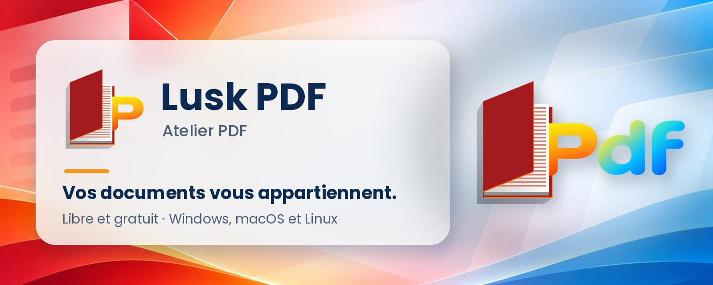

<p align="center">
  
</p>

<h3 align="center">Vos documents vous appartiennent.</h3>

<p align="center">
  Un logiciel libre et gratuit pour lire, annoter, remplir, signer et organiser vos PDF, porté par l'association Lusk (loi 1901).<br>
  Pour Windows, macOS et Linux. Sans compte, sans publicité, et vos fichiers restent chez vous.
</p>

<p align="center">
  <a href="https://github.com/declic29/Lusk_Pdf/releases/latest/download/Lusk-Pdf-Windows.msi"></a>
  <a href="https://github.com/declic29/Lusk_Pdf/releases/latest/download/Lusk-Pdf-Mac.dmg"></a>
  <a href="https://github.com/declic29/Lusk_Pdf/releases/latest/download/Lusk-Pdf-Linux.deb"></a>
</p>

<p align="center">
  <a href="https://github.com/declic29/Lusk_Pdf/releases/latest"></a>
  
  
  <a href="https://www.lusk.bzh"></a>
</p>

<p align="center">
  <a href="https://www.lusk.bzh"><b>lusk.bzh</b></a> ·
  <a href="https://github.com/declic29/Lusk_Pdf/releases">Toutes les versions</a> ·
  <a href="https://github.com/declic29/LuskOffice">Toute la suite avec Lusk Office</a> ·
  <a href="https://github.com/declic29/Lusk_Pdf/issues">Signaler un problème</a>
</p>

---

## Lusk PDF en bref

Lusk PDF ouvre, lit et modifie les fichiers PDF, sous Windows, macOS et Linux. Il fonctionne
entièrement sur votre ordinateur : pas de compte, pas de publicité, pas de mesure d'audience, et
vos documents ne sont jamais envoyés nulle part.

- **Lire confortablement** : affichage fidèle, recherche dans le texte, signets, vignettes,
  affichage page par page ou en continu, mode lecture, thème clair ou sombre.
- **Commenter et remplir** : surlignage, notes, dessins, tampons, fils de commentaires ;
  formulaires remplissables, création de champs, signature dessinée, tapée ou photographiée,
  signature numérique avec certificat.
- **Organiser** : déplacer, faire pivoter, extraire, insérer et supprimer des pages ; combiner
  plusieurs fichiers ou en découper un ; numérotation, en-têtes et pieds de page, filigranes.
- **Modifier et protéger** : retoucher le texte et les images, biffer des informations,
  protéger par mot de passe, gérer les autorisations, optimiser le poids d'un fichier.
- **Convertir et imprimer** : export en images, en texte et en Word ; impression en livret ;
  reconnaissance de texte (OCR) pour rendre un scan cherchable.
- **En français d'abord**, avec l'anglais au choix dans les Préférences ; correcteur
  d'orthographe français, breton et anglais dans les commentaires et le texte ajouté ; aide
  complète en français (menu **Aide**), qui fonctionne sans connexion.
- **OneDrive et Google Drive** : l'Accueil ouvre directement le dossier que ces applications
  synchronisent, sans que Lusk PDF se connecte à aucun compte.

## Télécharger et installer

Téléchargez la dernière version pour votre système :

| Système | Téléchargement |
|---|---|
| Windows (64 bits) | [**Lusk-Pdf-Windows.msi**](https://github.com/declic29/Lusk_Pdf/releases/latest/download/Lusk-Pdf-Windows.msi) |
| macOS (Apple et Intel) | [**Lusk-Pdf-Mac.dmg**](https://github.com/declic29/Lusk_Pdf/releases/latest/download/Lusk-Pdf-Mac.dmg) |
| Linux (toutes distributions) | [**Lusk-Pdf-Linux.AppImage**](https://github.com/declic29/Lusk_Pdf/releases/latest/download/Lusk-Pdf-Linux.AppImage) |
| Linux (Debian, Ubuntu, Mint) | [**Lusk-Pdf-Linux.deb**](https://github.com/declic29/Lusk_Pdf/releases/latest/download/Lusk-Pdf-Linux.deb) |

Les autres formats (version portable pour Windows sans installation, `.rpm` pour Fedora et
openSUSE, `.tar.gz`) et les versions précédentes sont sur la page
[Releases](https://github.com/declic29/Lusk_Pdf/releases). `SHA256SUMS.txt` donne l'empreinte de
chaque fichier, pour vérifier un téléchargement.

Une fois Lusk PDF installé, **Aide › Rechercher des mises à jour…** cherche et installe les
nouvelles versions.

**macOS.** Ouvrez le `.dmg` et glissez Lusk PDF dans Applications. L'application n'a pas de
certificat Apple : la première fois, macOS la bloque ; ouvrez **Réglages Système › Confidentialité
et sécurité**, puis cliquez sur **Ouvrir quand même**.

**Linux.** Rendez l'AppImage exécutable (`chmod +x`) puis lancez-la, ou installez le paquet de
votre distribution.

### Si Lusk PDF ne démarre pas

- **Windows, la fenêtre n'apparaît pas** : certains pilotes graphiques posent problème. Dans
  PowerShell, depuis le dossier du programme, essayez un autre moteur d'affichage :
  ```powershell
  $env:WGPU_BACKEND = "vulkan"
  & .\pdfcraft.exe
  ```
  `WGPU_BACKEND` accepte aussi `dx12` et `gl`, et `$env:PDFCRAFT_RENDERER = "gl"` force
  l'affichage OpenGL.
- Le **journal** se trouve dans le dossier de données de l'application : `%APPDATA%\PdfCraft\`
  (Windows), `~/Library/Application Support/PdfCraft/` (macOS) ou `~/.local/share/pdfcraft/`
  (Linux). Joignez-le à un signalement de problème.

## La suite Lusk

Lusk PDF fait partie de la suite libre et gratuite de l'association Lusk. Avec
**[Lusk Office](https://github.com/declic29/LuskOffice)**, un seul programme installe d'un coup les logiciels que vous cochez
(Windows, Linux et Mac).

<table>
  <tr>
    <td width="50%"><a href="https://github.com/declic29/LuskTX"></a></td>
    <td width="50%"><a href="https://github.com/declic29/LuskTab"></a></td>
  </tr>
  <tr>
    <td width="50%"><a href="https://github.com/declic29/Lusk-Diapo"></a></td>
    <td width="50%"><a href="https://www.lusk.bzh"></a></td>
  </tr>
</table>

## Compiler Lusk PDF

Il faut [Rust](https://rustup.rs) (version stable).

```sh
git clone https://github.com/declic29/Lusk_Pdf
cd Lusk_Pdf
cargo run --release -p pdfcraft                  # l'application
cargo run --release -p pdfcraft -- document.pdf  # ouvrir un document
```

La traduction française est dans le dépôt (`i18n/locales/fr/`) et toujours intégrée. Les polices
japonaises et chinoises sont facultatives : `CRAFT_FONTS_DIR=<copie de storytold/craft-fonts>`.
La reconnaissance de texte a besoin de ses modèles, que `cargo xtask models <dossier>` télécharge
(les installateurs les contiennent).

L'outil en ligne de commande traite les PDF sans ouvrir l'application :

```sh
cargo run --release -p pdfcraft-cli -- --help
```

Avant chaque envoi, `cargo xtask ci` vérifie la mise en forme du code, les tests et les
attributions des images, des polices et des traductions.

## Licence et origine

Lusk PDF est un logiciel libre, sous licence [MIT](LICENSE-MIT) ou [Apache 2.0](LICENSE-APACHE),
au choix. © 2026 Lusk, association loi 1901.

Lusk PDF est dérivé de PdfCraft, Copyright (c) 2026 ArtCraft Team and the PdfCraft
contributors, publié sous les mêmes licences. Les mentions obligatoires sont dans [NOTICE](NOTICE),
et l'auteur, la source et la licence de chaque image, police et traduction sont dans
[ATTRIBUTION.md](ATTRIBUTION.md).

Le logo de Lusk PDF appartient à l'association Lusk. Aucune icône, image ni police ne provient
d'Adobe Acrobat ou d'un autre logiciel commercial.
